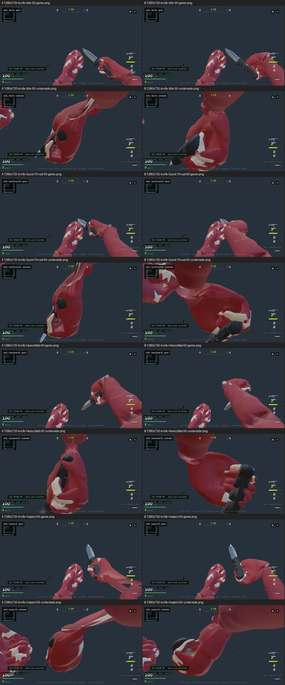
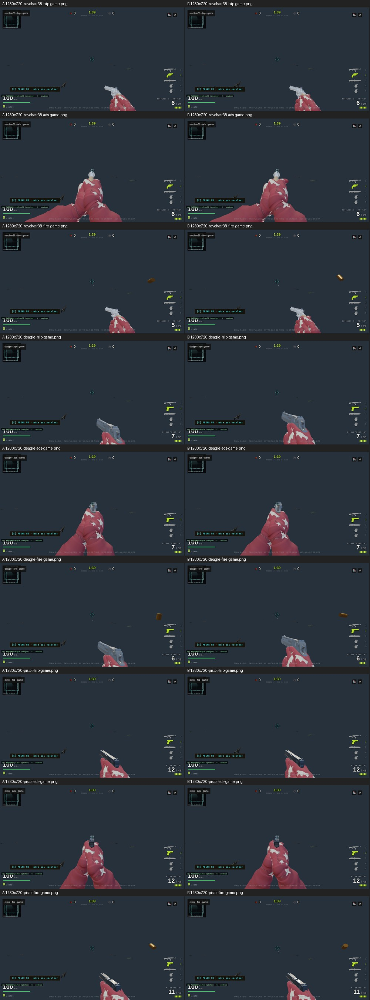

# Viewmodels — issue #991

Lote independente da revisão de balística. A faca K passa a adaptar as rotações do braço, punho e twist uma vez ao carregar o GLB. O cabo acompanha a cavidade da mão sem deslocar ombro ou lâmina. Somente o produto `revolver#revolver38` recebe a adaptação; fábrica, golden e retarget permanecem intactos. A .38 clona os clipes antes de ajustar três falanges do índice; outras armas preservam o cache original. A Deagle sobe 45 mm no frame de quadril. A PT-38 permanece como referência.

Não há alteração de GLB, pesos, vértices, dano, cadência, alcance ou trajetória da lâmina. Os tempos e a interpolação de todas as tracks são comparados; somente quatro tracks de quaternion da faca e três do índice da .38 podem mudar de valores.

## Antes/depois no jogo real

A é o controle `vmgrip=0`, B é o comportamento padrão, ambos com o mesmo código e os mesmos assets autorados. Capturas em 1200×800 (3:2) e 1280×720 (16:9), qualidade baixa/SwiftShader. O capturador oculta o cenário para tornar a silhueta legível, conserva o controlador real e avança ações de gameplay e clipes em passos determinísticos. Isso é QA de poses, não playtest humano contínuo.





Foram capturadas 450 imagens por variante: sete clipes da faca em cinco fases e três vistas; clipes das três armas curtas, ações reais de quadril/ADS/disparo e AK de referência. Uma restrição posterior de escopo limitou a adaptação da .38 à chave K já usada nas capturas, sem mudar sua pose. Os manifestos resumidos conservam os hashes da captura, anteriores a essa restrição. Incluem hashes das fontes, ausência de erros de página e maior heap observado: [controle](evidence/viewmodels-991/baseline-full-manifest.json), [correção](evidence/viewmodels-991/after-full-manifest.json). Maior heap JS observado na correção: 227,93 MiB; esse valor não representa a memória total do navegador.

A máscara raster da Deagle em 16:9 tinha 6,67 px CSS de margem inferior; passou a 84 px. A PT-38 usada como referência tem 68 px. Em 3:2, Deagle 69,33 → 141,33 px; PT-38 126,67 px. As [máscaras e medidas](evidence/viewmodels-991/frame-masks.json) estão versionadas; branco é arma visível, preto inclui oclusão pelas mãos. Medição converte o framebuffer de qualidade baixa (75%) para CSS. FOV, escala e ângulos permanecem iguais. ADS foi capturado separadamente e julgado centralizado pelo crítico.

## Régua de contato e limites

`npm run eval:vm-grip-contact` lê os GLBs autorados e usa os consumidores `_accept` e `_loadFamily`; substitui apenas I/O e texturas na execução Node. O wrapper inteiro recebe `parent.updateMatrixWorld(true)` antes da medição, preservando a atualização de `bindMatrixInverse` dos SkinnedMesh.

Amostragem: 13 poses por clipe, 91 da faca e 65 da .38. [CSV por pose](evidence/viewmodels-991/contact.csv).

| Medida | Controle | Correção |
|---|---:|---:|
| Maior ângulo cabo/linha entre dedos | 60,433° | 0,308° |
| Maior número de pares palma/cabo em interseção | 427 | 0 |
| Maior distância do terceiro dedo mais próximo ao cabo | 66,335 mm | 0,091 mm |
| Maior razão de alongamento de aresta no punho | 11,777 | 3,167 |
| Maior número de pares índice/metal do guarda-mato | 63 | 0 |
| Maior distância índice/gatilho durante disparo | 3,805 mm | 4,799 mm |

O limite de contato de 5 mm tolera a superfície da luva e exige proximidade real de três dedos; o gatilho usa o mesmo limite. O limite de 15° separa a pega perpendicular observada no controle da pega ao longo do cabo. São critérios operacionais deste asset e desta correção, não medidas anatômicas universais. O punho exige melhoria contra o mesmo GLB original, sem alegar deformação zero.

A interseção usa arestas/triângulos. Um complemento testa contenção com três raios e tolerância superficial de 0,2 mm; um fixture fechado prova que uma região inteiramente embutida, sem cruzamento de superfícies, é detectada. Recortes abertos, componentes sobrepostos e degenerações podem produzir falsos negativos, especialmente na seleção de faces do guarda-mato. Resultado zero significa ausência detectada nas poses amostradas; não prova universal de ausência de penetração.

Os mutantes restauram o controle, afastam a faca, deslocam o ombro, alteram a trajetória da lâmina, afastam o índice e deformam o twist da manga. Cada execução exige falha nas cláusulas correspondentes. Ausência de asset reprova; o portão privado não é acrescentado ao CI público, que não possui esses binários.

## Crítica independente

Revisão de pixels em resolução original e sheets, com amostras dos sete clipes e dos dois aspectos; o crítico não examinou individualmente todas as 900 imagens.

- Deagle: **APROVADA** nas figuras; margem melhor e ADS centralizado.
- PT-38: **APROVADA** nas figuras; nenhum defeito novo demonstrado.
- Faca: **RESSALVA**. Cabo atravessando a palma corrigido; contato aparente nos sete clipes. Persiste uma dobra volumosa e angular na junção luva/manga, sobretudo Idle, Inspect e HeavyStab. O punho não tem aceite visual final.
- .38: **RESSALVA**. Gameplay, ADS, recarga e inspect íntegros nas amostras. Closes de idle encobrem/cortam parte importante do índice e guarda-mato; shoot na vista oposta mostra melhor a região, sem atravessamento claro. Falta prova visual completa desse contato.

A issue permanece aberta. Este lote deve seguir em rascunho para staging e revisão humana de gameplay; não promover assets nem ligar VM_LAUNCH com base neste relatório.

## Checks do lote

Build, contrato de rig com assets autorizados, chave de ativação com mutantes e fixture geométrico passaram. `check:fast`: 236/249; as treze falhas também foram reproduzidas no checkout isolado da base exata, sem as mudanças deste lote. São falhas de release, mapas, áudio, grafites e insumos ausentes; nenhum teto foi afrouxado. [Resultados e reprodução na base](evidence/viewmodels-991/validation.json). As réguas de imagem das três curtas passaram em ambos os aspectos.

## Reprodução

Os assets privados devem vir do catálogo autorizado, preservando bytes e nomes do manifesto. Nenhum binário é incluído neste PR.

| GLB | Bytes | SHA-256 |
|---|---:|---|
| `knife/knife-baked-runtime.glb` | 1487908 | `93028919ee74f46ed8ef77c8e34ceec314f4e76b2e069b4686b65d1cb84f0556` |
| `revolver/revolver-runtime.glb` | 4186328 | `40b53e2fba7309ee210f0199f69fd7227c544b197d409904faaa4981231f796e` |
| `deagle/deagle-runtime.glb` | 3443296 | `e480f69e76f892b5b7ad3d49d1a69f24fe0c8515735faa1c7cd86de7a2583c97` |
| `pistol/pistol-runtime.glb` | 3006796 | `04c126d93148f9cf0ffa07927f4d09cde2067d9abbc9ddcd25d3b811923fa3b8` |


```sh
CSBRASIL_VM_ASSET_ROOT=/caminho/viewmodels npm run eval:vm-grip-contact
# Servidor Astro local já ativo; private-assets/viewmodels serve o catálogo autorizado.
VM_QA_URL=http://127.0.0.1:4387/ VM_QA_OUT=/tmp/vm991-after node tools/eval/vm-grip-capture.mjs
VM_QA_BASELINE=1 VM_QA_URL=http://127.0.0.1:4387/ VM_QA_OUT=/tmp/vm991-before node tools/eval/vm-grip-capture.mjs
```

`VM_QA_FRAME_ONLY=1` limita a captura às pistolas em quadril/ADS e produz as máscaras; a margem CSS é `alturaCSS - (últimaLinhaBranca + 1) * alturaCSS / alturaRaster`, com branco definido por R > 240.

Executar um navegador ou teste pesado por vez, com heap Node limitado. `vmgrip=0` é também controle de rollback local; não altera os binários nem promove estado de prontidão.
