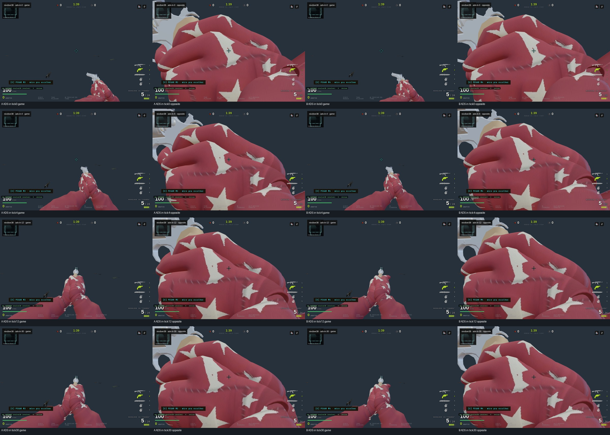
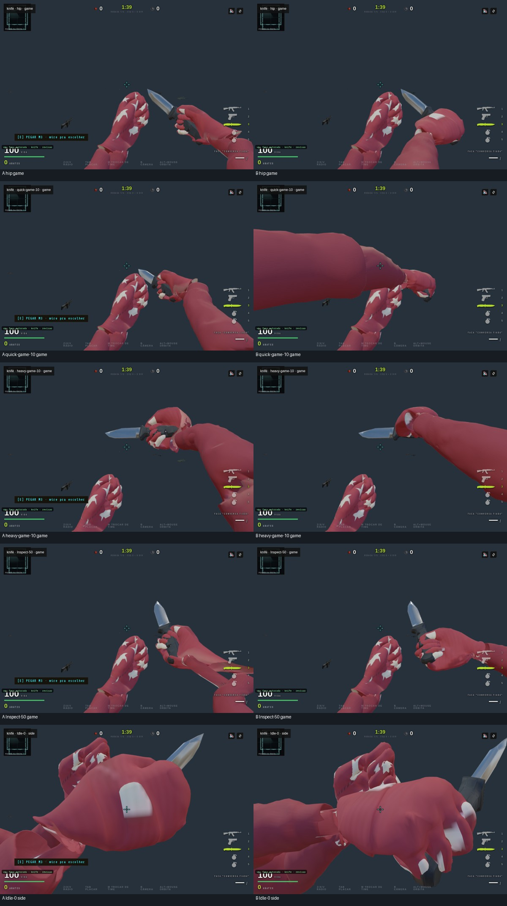
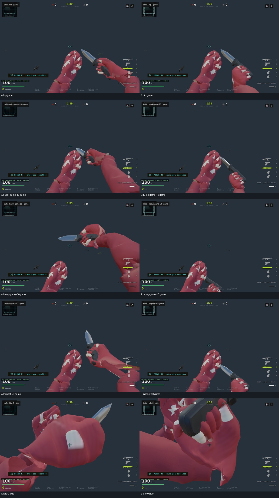

# Viewmodels — issue #991

**ADS da .38 corrigido neste recorte; faca ainda bloqueada.** O produto K `revolver#revolver38` preserva a camada aditiva autorada de ADS e interpola a mão direita no referencial da arma. Os extremos hip/ADS são amostrados na mesma ação e no mesmo instante, restaurando o peso original; a pose aplicada é retirada antes da próxima atualização do mixer. Os ajustes anteriores das três falanges permanecem em clipes clonados. Fábrica, golden e retarget ficam fora dessa adaptação; `vmgrip=0` reproduz o controle.

A Deagle mantém o enquadramento já revisado e a PT-38 continua como referência. Não houve alteração de GLBs, pesos, vértices, cadência, dano, alcance ou balística. Após duas novas reprovações cegas, as adaptações experimentais da faca foram retiradas. `meleevm.js` e `vmgrip.js` permanecem idênticos ao commit `9e2306075`.

## Validação do recorte mantido

A régua carrega os bytes autorados pelos consumidores reais, substituindo apenas I/O e texturas em Node. Para a .38, inicia `setWeapon`, aguarda o carregamento e usa `setAim/update` no produto K. A rota de revisão é explícita. O wrapper completo recebe `parent.updateMatrixWorld(true)` para atualizar o bind dos SkinnedMesh.

A varredura da .38 cobre 202 poses: quatro clipes completos e cinco fases de idle/disparo cruzadas com quinze pesos de ADS, incluindo os extremos e suas vizinhanças. Isso substitui a antiga associação diagonal de fase/peso e a montagem incompleta do consumidor. Resultados antigos têm outra cobertura e não são diretamente equivalentes.

| Medida autorada atual | Resultado |
|---|---:|
| Interseções detectadas índice/metal | 0 |
| Maior distância índice/gatilho no disparo | 4,799 mm |
| Maior deslocamento junto aos extremos ADS | 0,000634 mm |
| Deriva de relógio e escala da mão | 0 |

O teto existente de gatilho permanece 5 mm; a tolerância geométrica existente de 0,2 mm também verifica as vizinhanças dos extremos. Serial, fila e tempos das ações permanecem iguais durante as amostragens `update(0)`. A suíte isolada `--revolver-only` usa os mesmos predicados da régua completa e detectou seis negativos: baseline, dedo solto, retirada da adaptação ADS, salto no extremo, avanço do relógio e alteração de escala. A régua padrão continua vermelha pela faca.

O crítico cego leu as dezoito folhas atuais: AK A/B **APROVADA**, .38 A/B **RESSALVA**. Não demonstrou piora material em B nem salto claro na entrada/saída ADS, inclusive sob disparo. Recarga sem abertura/inserção legível, inspeção pouco expressiva e estojo voando após tiro permanecem ressalvas em A e B. [Veredito e limites](evidence/viewmodels-991/shortgun-critics.json).

Foram concluídas 248 capturas por variante em 1200×800 e 1280×720, com Game real, cenário oculto e avanço determinístico. Não ocorreram exceções de página; isso não significa ausência de todo aviso HTTP/console. [Procedência compacta](evidence/viewmodels-991/browser-current.json). As mesmas 300 atualizações de benchmark foram executadas em A/B para manter as fases comparáveis. Em B, `controller.update` no ADS intermediário teve P95 de 0,3/0,2 ms; não mede o frame GPU inteiro. A transição usa quatro atualizações do mixer, três com delta zero, sem alocações por frame. Heap JS máximo observado: 214,58 MiB em B, não RSS total.



Deagle e PT-38 conservam as margens medidas em [frame-masks.json](evidence/viewmodels-991/frame-masks.json). FOV, escala e ângulos não mudaram neste recorte. A captura exclui explicitamente `revolver ads` isolado e `pistol inspect` parcial sem chamada pública no Game, registrando os canais e a razão.

## Faca: tentativas retiradas

A primeira abordagem nova aplicava uma transformação rígida ao braço depois do mixer, preservando a lâmina. Contato e crossfades passaram, mas o crítico cego reprovou a manga cruzando o centro em Slash/QuickThrust. Métrica verde não compensou a perda de legibilidade.



A segunda abordagem apresentada ao crítico neutralizava o punho, calibrava o repouso e fazia a lâmina seguir o antebraço autorado. Melhorou contato e estiramento, mas apagou a leitura de Slash/Stab/Inspect e deixou o pesado abaixo do quadro. Também foi reprovada nos dois aspectos. Não integra o runtime.



O primeiro crítico leu dez folhas; o segundo, vinte, com sete clipes em cinco fases, três vistas e sequências quick/heavy incluindo o retorno. Ambos tinham contexto limpo e receberam apenas figuras e referências aprovadas. [Vereditos e limites](evidence/viewmodels-991/knife-critics.json).

A skill [`vm-critico-visual`](../../.claude/skills/vm-critico-visual/SKILL.md) exige trocar de frente ou reportar platô após duas rodadas sem melhorar o veredito. A faca permanece sem solução aprovada. A próxima investigação deve rever braço, punho, lâmina e gestos como conjunto, incluindo o retarget de `tools/viewmodels/prep/knife-k-build.py`; apenas alinhar contato ou fixar um socket não preservou a ação.

As figuras anteriores `knife-ab.jpg` e `knife-parent-rejected.jpg` também representam candidatos rejeitados. Os manifestos `baseline-full/after-full` existentes pertencem à primeira tentativa antiga; não descrevem o runtime atual.

## Estado completo e limites

A régua padrão cobre 143 poses da faca: sete clipes e 52 amostras de mistura de entrada/saída dos ataques reais. A faca original continua com máximo de 516 interseções palma/lâmina, 66,335 mm até o terceiro dedo e razão de aresta de punho 11,777. São falhas conhecidas preservadas, não aceite. Tracks e hierarquia são observados separadamente; não há uma certificação nova de trajetória mundial baseada em comparação da matriz consigo mesma.

[Resultados atuais e pendências](evidence/viewmodels-991/pending.json), [CSV por pose](evidence/viewmodels-991/contact.csv), [validação e procedência](evidence/viewmodels-991/validation.json). A suíte completa de mutações não certifica o estado atual porque exige controle verde primeiro. Uma execução verde de onze negativos existiu para o braço rígido rejeitado; não vale para o runtime publicado.

Interseções por triângulos e contenção por três raios, tolerância de 0,2 mm, têm limitações em superfícies abertas, sobrepostas ou degeneradas. Zero significa ausência detectada nas poses medidas. Não cobre todas as combinações contínuas de ADS/disparo/recarga nem substitui gameplay humano.

`check:fast` anterior registrou 236/249; as treze falhas foram reproduzidas na base exata `e8c4a2c4b41b952674e6ec7342b4bb82178ebc99`. Esses resultados estão identificados como históricos. Checks locais finais, incluindo vm/kick/rig/launch/shaderbudget/modgraph/melee, transições, fixture, docs, arch e build, passaram; os códigos estão em `validation.json`. O CI deve ser consultado no SHA atual do PR; Vercel requer autorização externa de mantenedor. Manter draft, issue aberta, staging e gameplay humano pendentes. Sem merge, deploy, promoção de assets ou mudança em VM_LAUNCH.

## Reprodução

| GLB | Bytes | SHA-256 |
|---|---:|---|
| `knife/knife-baked-runtime.glb` | 1487908 | `93028919ee74f46ed8ef77c8e34ceec314f4e76b2e069b4686b65d1cb84f0556` |
| `revolver/revolver-runtime.glb` | 4186328 | `40b53e2fba7309ee210f0199f69fd7227c544b197d409904faaa4981231f796e` |
| `deagle/deagle-runtime.glb` | 3443296 | `e480f69e76f892b5b7ad3d49d1a69f24fe0c8515735faa1c7cd86de7a2583c97` |
| `pistol/pistol-runtime.glb` | 3006796 | `04c126d93148f9cf0ffa07927f4d09cde2067d9abbc9ddcd25d3b811923fa3b8` |

```sh
CSBRASIL_VM_ASSET_ROOT=/caminho/viewmodels npm run eval:vm-grip-contact
# Padrão completo: vermelho enquanto a faca permanecer pendente.
CSBRASIL_VM_ASSET_ROOT=/caminho/viewmodels node tools/eval/vm-grip-contact-check.mjs --revolver-only
CSBRASIL_VM_ASSET_ROOT=/caminho/viewmodels node tools/eval/vm-grip-contact-mutations.mjs --revolver-only
# Servidor Astro e catálogo privado autorizado necessários; um browser por vez.
VM_QA_WEAPONS=revolver38,deagle,pistol,ak VM_QA_OUT=/tmp/vm991-after node tools/eval/vm-grip-capture.mjs
VM_QA_BASELINE=1 VM_QA_WEAPONS=revolver38,deagle,pistol,ak VM_QA_OUT=/tmp/vm991-before node tools/eval/vm-grip-capture.mjs
```

`VM_QA_FRAME_ONLY=1` limita a captura ao enquadramento das pistolas. Use heap limitado e mantenha os assets privados fora do Git. Os quadros de faca dos candidatos rejeitados são evidência negativa, não proposta de promoção.
