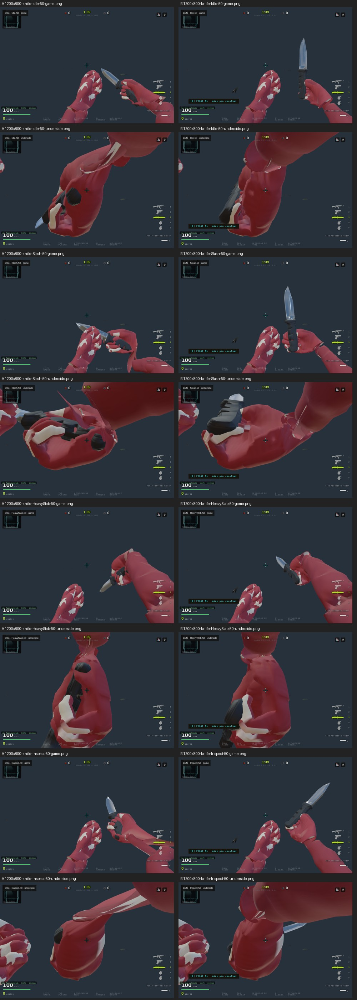

# Viewmodels — issue #991

**Lote incompleto, bloqueado para merge.** Duas críticas cegas reprovaram as tentativas de correção da faca. A adaptação publicada em `596ba6a` foi retirada: o runtime voltou à faca original, com seu defeito conhecido, sem reparenting ou alteração de tracks. A issue permanece aberta. CI público verde não equivale a aceite visual ou de contato.

O recorte mantido sobe a Deagle 45 mm no frame de quadril e adapta três falanges do índice somente no produto `revolver#revolver38`, clonando seus clipes. A PT-38 permanece como referência. Fábrica, golden e retarget não recebem essa adaptação. A .38 melhorou nas poses já medidas, mas a nova medição da transição ADS encontrou interseções e impede considerá-la corrigida.

Nenhum GLB, peso, vértice, dano, cadência ou alcance foi alterado. A faca preserva integralmente a hierarquia e as animações originais. Os assets privados permanecem fora do Git.

## Evidência visual e tentativas rejeitadas

A e B usam os mesmos assets autorados, em 1200×800 (3:2) e 1280×720 (16:9). O capturador oculta o cenário para facilitar a leitura e avança poses determinísticas; isso não substitui movimento contínuo ou playtest humano.


O primeiro candidato preservava a lâmina e adaptava o braço com IK. A crítica cega reprovou a palma aberta/inflada, a leitura dos dedos e a ligação abrupta do punho. A nota anterior de RESSALVA veio de contexto que não era suficientemente cego e foi invalidada.



O segundo candidato fixava a lâmina à mão e preservava seu gesto original. Melhorou os rasgos no punho, mas deixou os dedos atrás do cabo sem envolvê-lo e tornou as estocadas quase verticais. Foi REPROVADO em QuickThrust, Stab, Slash e HeavyStab; Idle, Draw e Inspect tiveram ressalvas. O crítico examinou os sete clipes na fase central, três vistas e dois aspectos, além de fases 25/75 selecionadas; não examinou todos os quadros nem vídeo contínuo. Esse candidato não integra o runtime.

A skill `vm-critico-visual` exige trocar de frente ou reportar o platô depois de duas rodadas sem melhora de veredito. A investigação foi interrompida nesse ponto, sem promover o asset ou alterar VM_LAUNCH.


Deagle e PT-38 foram aprovadas nas figuras de gameplay. A máscara da Deagle em 16:9 passou de 6,67 para 84 px CSS de margem inferior; a PT-38 tem 68 px. Em 3:2, Deagle 69,33 → 141,33 px; PT-38 126,67 px. FOV, escala e ângulos não mudaram. [Máscaras e medidas](evidence/viewmodels-991/frame-masks.json).

Os manifestos [baseline-full](evidence/viewmodels-991/baseline-full-manifest.json) e [after-full](evidence/viewmodels-991/after-full-manifest.json) são **histórico da primeira tentativa rejeitada**, não uma captura do HEAD atual. Registram 450 imagens por variante, zero exceções de página e heap JS até 227,93 MiB. A segunda tentativa gerou 222 imagens de faca/AK, zero exceções e heap JS até 202,18 MiB. Esses valores não são a memória total do navegador.

## Correção da instrumentação e pendências

O capturador anterior tocava `revolver ads` isoladamente, embora seus sete canais sejam uma camada aditiva sobre idle. Também tocava `pistol inspect`, com dois canais parciais e sem chamada pública no Game. Os quadros vazios/invertidos desses dois diagnósticos não demonstram regressão de gameplay e não servem como aceite. O capturador agora exclui explicitamente essas combinações inválidas, registra canais/motivo e conserva a captura da ação ADS real. Essa revisão do capturador ainda requer nova execução completa.

A régua de contato usa os consumidores `_accept` e `_loadFamily`, substituindo somente I/O e texturas em Node. `parent.updateMatrixWorld(true)` atualiza corretamente o bindMatrixInverse dos SkinnedMesh. ADS agora usa idle mais a ação aditiva real. A varredura associa fase do idle e peso ADS: não cobre todas as combinações nem ADS sobre disparo/recarga.

A nova execução, com a faca original e a adaptação mantida da .38, **saiu 1**. [Resumo e pendências](evidence/viewmodels-991/pending.json), [CSV por pose](evidence/viewmodels-991/contact.csv).

| Medida atual | Resultado |
|---|---:|
| Poses da faca / .38 | 91 / 65 |
| Maior contagem detectada de interseções palma/faca | 516 |
| Maior distância do terceiro dedo ao cabo | 66,335 mm |
| Maior razão de alongamento de aresta no punho | 11,777 |
| Maior contagem de interseções índice/metal da .38 | 10 |
| Maior distância índice/gatilho no disparo | 4,799 mm |

As interseções da .38 aparecem nos pesos ADS 0,25, 0,333 e 0,417, com contagens 4, 10 e 3. Idle, disparo, recarga e inspect não tiveram interseção detectada nessa amostra. O limite existente de 5 mm para gatilho passou; isso não compensa a falha durante ADS.

A razão cabo/linha entre metacarpos chegou perto de zero nos candidatos e ainda premiou pegas visualmente reprovadas. Seu teto de 15° não tem validade demonstrada para aprovar essa pega. Proximidade e contagem de interseções também não certificam envolvimento dos dedos. Nenhum teto foi afrouxado; o portão global permanece vermelho. A cláusula de manga exige melhoria sobre a faca original e necessariamente falha após a retirada da correção.

Interseção por triângulos e contenção por três raios, com tolerância de 0,2 mm, têm limitações em superfícies abertas, sobrepostas ou degeneradas. Zero significa ausência detectada nas poses medidas, não prova universal. O fixture fechado passou na validação anterior. O teste de mutações agora exige um controle verde antes de certificar qualquer mutante; o estado atual impede essa certificação.

## Checks e próximo aceite

Build, sintaxe dos arquivos alterados e fixture geométrico passaram após a retirada. O consumidor da faca é idêntico ao da base. Rig com 25 armas e ativação com mutantes passaram anteriormente em `596ba6a`. `check:fast` registrou 236/249; as treze falhas foram reproduzidas na base exata `e8c4a2c4b41b952674e6ec7342b4bb82178ebc99`. Esses resultados são históricos, identificados como tal em [validation.json](evidence/viewmodels-991/validation.json). O CI público desse SHA passou nos checks de código; Vercel exige autorização humana de mantenedor, não concedida.

Para concluir: reconstruir a relação mão/cabo sem piorar os golpes, obter nova crítica cega, corrigir a transição ADS da .38 e repetir capturas/contato/mutantes com controle verde. Depois, staging e gameplay humano. Nenhum merge, deploy ou promoção está autorizado por este relatório.

## Reprodução

| GLB | Bytes | SHA-256 |
|---|---:|---|
| `knife/knife-baked-runtime.glb` | 1487908 | `93028919ee74f46ed8ef77c8e34ceec314f4e76b2e069b4686b65d1cb84f0556` |
| `revolver/revolver-runtime.glb` | 4186328 | `40b53e2fba7309ee210f0199f69fd7227c544b197d409904faaa4981231f796e` |
| `deagle/deagle-runtime.glb` | 3443296 | `e480f69e76f892b5b7ad3d49d1a69f24fe0c8515735faa1c7cd86de7a2583c97` |
| `pistol/pistol-runtime.glb` | 3006796 | `04c126d93148f9cf0ffa07927f4d09cde2067d9abbc9ddcd25d3b811923fa3b8` |

```sh
CSBRASIL_VM_ASSET_ROOT=/caminho/viewmodels npm run eval:vm-grip-contact
# Resultado atual esperado: vermelho; não considerar certificação.
# Servidor Astro e catálogo privado autorizado necessários para capturas.
VM_QA_URL=http://127.0.0.1:4387/ VM_QA_OUT=/tmp/vm991-after node tools/eval/vm-grip-capture.mjs
VM_QA_BASELINE=1 VM_QA_URL=http://127.0.0.1:4387/ VM_QA_OUT=/tmp/vm991-before node tools/eval/vm-grip-capture.mjs
```

`VM_QA_FRAME_ONLY=1` limita a captura às pistolas em quadril/ADS e produz máscaras. `VM_QA_WEAPONS` permite um subconjunto do catálogo. Executar um navegador ou teste pesado por vez, com heap limitado. `vmgrip=0` mantém o controle local da .38 e do enquadramento, sem alterar binários.
