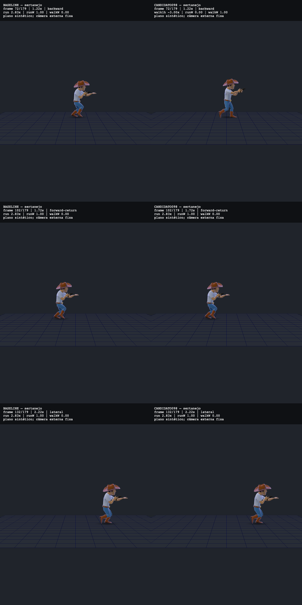
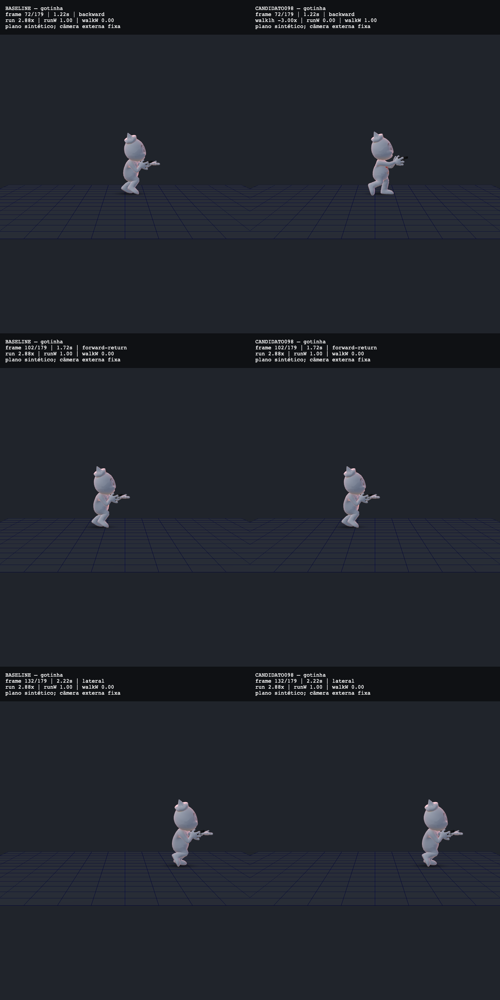

# Recuo do corpo local em terceira pessoa

Ao andar para trás, o corpo local continuava usando a corrida para a frente: Game._updatePlayerTP sempre passava back=false ao controlador. A mudança projeta a velocidade horizontal na direção do jogador e encaminha o sinal para o caminho reverso existente. O limiar−0.25 vem dos callers de bots e jogadores remotos. Física, mira e câmera não são alteradas.

## Comparação visual da camada

Base imediata:773427b19ea33f96a9a2d249ab7ed1ce65510ce9, PR980. Esquerda: base. Direita: candidato com apenas as duas linhas deste patch. Mesmos personagens/armas originais, câmera externa fixa, luz, piso sintético e resolução1500×1000 por quadro. Cada prancha contém recuo1.2167s, retorno à frente1.7167s e lateral2.2167s, medidos no relógio simulado. Não é captura do renderer completo de uma partida.





No recuo, o candidato troca a pose de corrida pelo walk reverso. Retorno e lateral voltam a poses correspondentes nas amostras. A mão de suporte continua aberta, sobretudo na Gotinha: esta camada não corrige empunhadura. O clamp de animação até3× já existia e continua; passada natural, contato com o piso, suavidade completa e flicker não foram aprovados. Os vídeos locais de apoio incluem carregamento e não medem FPS.

As capturas118 usam os clipes da baseC, incluindo Curl_L/R; as imagens anteriores da investigaçãoA não foram usadas como evidência desta camada. Originais e recibos ficam no diretório externo analysis-media/2026-10-15-visual-factory/evidence/tp-local-backpedal-stack-temporal-118. Nenhum GLB foi substituído. As duas pranchas são os únicos arquivos de mídia incluídos para revisão.

## Reprodução e limites da régua

```sh
npm run eval:tpbackpedal
node tools/eval/tp-local-backpedal-check.mjs --mutante=no-back
node tools/eval/tp-local-backpedal-check.mjs --mutante=wrong-sign
node tools/eval/tp-local-backpedal-check.mjs --mutante=player
```

O primeiro comando passa36/36 com Game._moveEntity, Game._updatePlayerTP, GLTFLoader e CharController reais. Antes do patch21/36 passam. Mutantes aplicados devem sair1, respectivamente21/36,0/36,0/36. São casos numéricos de direção, não36 melhorias artísticas. O gate compara2160frames de autoridade e1260frames fora do recuo exatamente; não é oracle independente da magnitude de rate nem teste completo de transições. Textura branca e física plana são stubs declarados; clipes, mixer e controlador são reais.

Para conferir jogando, abra o servidor de desenvolvimento, selecione câmera de terceira pessoa nas configurações e compare frente, recuo e lateral com Sertanejo/revólver e Gotinha/pistola. Esse teste humano continua pendente. Não há validação de multiplayer, mapa, colisão de câmera, recarga ou orçamento de performance nesta camada.
