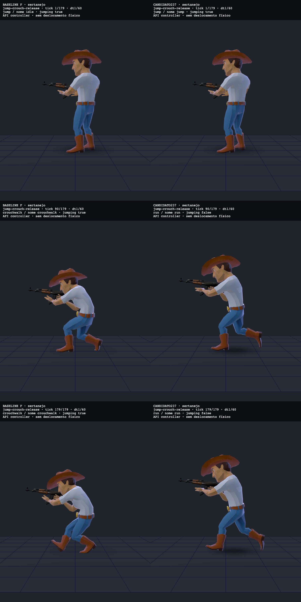
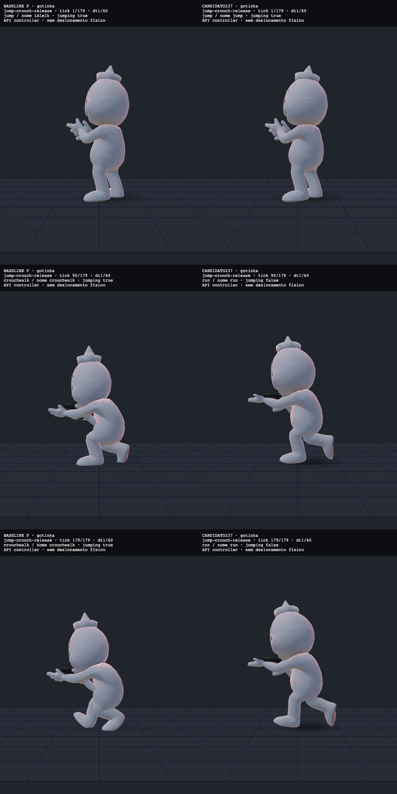

# Retorno após interromper o salto

Quando o controlador trocava o salto por tiro, crouch ou morte, `jumping` podia continuar ativo. Depois do evento, o corpo permanecia em `walkfire`, `crouchwalk` ou idle mesmo recebendo movimento. Esta camada encerra esse estado quando outra ação realmente assume o corpo e no revive.

Uma tentativa recusada, como selecionar um clipe ausente, preserva a ação atual. O salto passa a identificar `curName` como `jump`. Isso também afeta a elegibilidade do clamp do mount; limpar `jumping` afeta o consumidor da sombra. Não foram alterados offsets, poses, assets, fades, prioridades, física ou eventos de rede.

## Antes e depois

Esquerda: base imediata, PR [#989](https://github.com/corosolto/client/pull/989), commit `6a63bd23fbac81ea4ffeeb7fa8952aced5b9f763`. Direita: fonte desta correção, SHA256 `be17aeaf28f69d5e1fbffab0815156164cc895ab9520348c2624dde21e30afea`, byte a byte igual ao candidato observado. As capturas usam o controlador diretamente, com modelos e texturas originais, piso sintético e grupos estacionários. O Game ainda não encaminha o salto local ao controlador.

O caso mostrado inicia jump, aciona crouch no tick 2 e solta no 30, mantendo a entrada de movimento. Nos ticks 90 e 179, o baseline conserva a postura baixa de `crouchwalk`; o candidato apresenta a pose de corrida. Não há translação física nesta bancada.

Cada sheet concatena os RAWs dos ticks 1, 90 e 179 sem redimensionar ou recortar. Cada RAW tem 1500 x 1000 pixels, com dois painéis de 750 x 1000. Instantes simulados após o update: 0,033 s, 1,517 s e 3,000 s. A câmera comum fica em [4,49418; 0,821893; 0,134435], olha para [0; 0,821893; 0,134435], FOV 40 graus, antialias ativo e pixel ratio 1. Câmera, piso, iluminação, resolução e perfil são iguais nos pares e nos dois personagens.

A observação completa contém quatro sequências por piloto: salto isolado, interrupção por tiro, morte/revive e crouch/release. Cada sequência tem 180 updates de 1/60 s e journal de ações/flags. As três fotos deixam intervalos sem pixels; não mostram o fade inteiro nem os instantes dos eventos intermediários.

## Validação e limites

`npm run eval:tpjumpownership` mede o controlador, rigs e clipes reais em CPU, com textura branca. Cobre seleção/retorno, guards, ausência de clipes, revive, ordem inversa tiro/salto e controles idle/tiro. Na integração deste branch, o baseline reproduz 18/40; o candidato, 40/40. Remover apenas o cancelamento em `_to` deixa 32/40. Uma revisão independente adicional verificou recusas e mesma ação, além do contrato de tiro anterior. O contrato de tiro foi reexecutado neste branch: 179/179.

Na execução completa deste branch, `npm run check:deploy` passou 67/67 (55,531 s) e `npm run build` terminou com exit 0 (11,893 s). `npm run check:fast` ficou **243/254, exit 1** (1.054,523 s): falharam `eval:mapid`, `audio:check`, `eval:grafite`, `eval:grafite:ar`, `eval:grafite-editorial`, `eval:audiofablocal`, `eval:audiovoicemix`, `eval:decal-ink`, `eval:texture-quality-sampler`, `eval:backendhints` e `eval:mansao`. São os mesmos nomes registrados em F; isso não comprova igualdade de ambiente nem torna a suíte verde. O relatório de pickup gerado foi preservado fora do Git e restaurado seletivamente.

O `SIM_HASH` consultado sem `--write` mudou de `316b75ec32f55fdb` (F) para `72b8e81df72cda0a` (G). O grafo inclui glbchars; diferença de fingerprint não demonstra divergência física. Uma release futura precisa da sincronização normal cliente/backend. Não houve bump ou alteração do hash de release nesta camada.

A revisão visual independente aceitou somente um candidato funcional para draft. Nas amostras, o retorno aparece no corpo e não houve regressão óbvia no salto isolado. **Empunhadura, passada, suavidade, aterrissagem e sombra de contato continuam sem aprovação geral.** A Gotinha mantém a pistola junto de uma palma aberta; o retorno a run expõe essa limitação existente.

Esta camada não liga salto no Game, não adiciona recarga corporal, ação de faca ou mira específica. Também não comprova desempenho, câmera de gameplay, multiplayer humano ou igualdade de interpolação CPU/browser. O diagnóstico numérico anterior continua separado e vermelho.

## Continuação

Camada funcional sobre #989, preservando a stack #979, #980, #986 e #987. A próxima frente de combate prioriza poses próprias para pistolas e facas e recarga corporal sincronizada, com autoria e capacidades separadas por família de rig. A fábrica modular, câmera, mapas e ambiência permanecem no programa. Merge, deploy e ativação da loja continuam pendentes.
