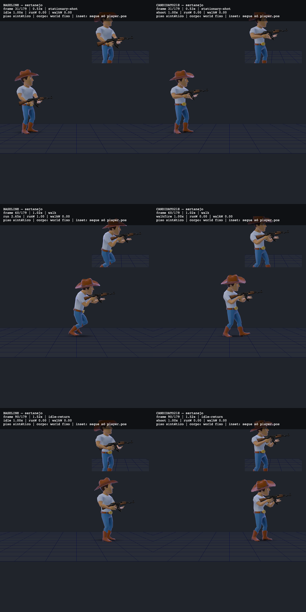
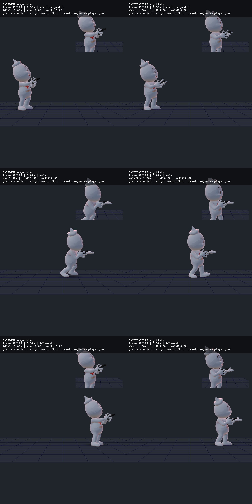

# Tiro local em terceira pessoa

O disparo aceito em terceira pessoa e na câmera de ombro agora aciona o controlador do personagem local. Antes, `Game._tryShoot()` acionava o viewmodel, mas o corpo local permanecia sem esse evento. A primeira pessoa continua sem encaminhar o evento ao corpo oculto.

Se o personagem para durante o disparo, o controlador sai de `walkfire` e retoma `shoot` na fase do evento original. Preserva o prazo, o listener de término, o modo de reprodução e o fade existente. O estado de tiro expira também fora do ramo de caminhada. `curName` passa a refletir `shoot`; isso também muda a apresentação do mount e a escolha posterior do offset do clipe.

## Comparação observada

Esquerda: base imediata da stack, biblioteca de roupas. Direita: candidato desta correção. Os painéis usam os assets originais, Game/controlador reais, câmera externa fixa e um piso sintético. O inset acompanha somente a posição física. Cada imagem reúne os passos 31, 60 e 90, sem redimensionar os PNGs originais.

Na observação temporal dos dois personagens, o disparo ocorre no passo 30. `walkfire` entra no 42; após soltar o movimento no 66, a velocidade cai abaixo do limite de caminhada no 76. Nesse passo, o candidato retoma `shoot` sem novo disparo nem reset. O peso de `walkfire` chega a zero no 86, o evento termina no 99 e o repouso entra no 100. A simulação tem 180 passos de 1/60 s.

Os vídeos foram decodificados integralmente na revisão independente. Incluem carregamento e pausas da coleta de evidências, portanto sua duração e cadência codificada não medem FPS nem representam todos os passos da simulação.

## Validação e limites

`npm run eval:tplocalshot` usa Game, controlador, rigs, armas e clipes do checkout real em CPU, com textura branca. Verifica encaminhamento, guards de tiro, cooldown, fase, retorno parado, término, morte/revive, crouch e ausência de clipes opcionais. Compara física, câmera e aim contra um controle que aceita o mesmo tiro sem receber o evento TP. Não copia o algoritmo de disparo.

Na integração local, passaram 179/179 verificações. Remover o encaminhamento deixa 96/149; remover o retorno parado deixa 161/179; reiniciar a fase deixa 167/179; remover a expiração ou antecipá-la deixa 175/179. Os mutantes são cópias externas dos módulos reais, com imports redirecionados ao mesmo checkout. O teste aceita `--game-module` e `--glb-module` para essa reprodução; sem overrides, verifica os fontes reais. `--out` opcional salva observações em arquivo novo antes da saída por reprovação, exceto erro que interrompa a execução.

`npm run build` e `npm run check:deploy` passaram (66/66 no deploy). O `check:fast` completo terminou vermelho: 242/253. Dois checks de grafite recusaram `BASE` ausente antes de abrir browser; os nove outros repetem classes de falha já registradas na base: mapas, áudio, editorial, assets ausentes e fixture de renderer. Os scripts de entrada dos 11 checks são idênticos aos da base imediata. Isso não substitui um teste da base no mesmo ambiente nem torna o resultado geral verde.

O fingerprint de fontes `SIM_HASH` muda porque o grafo inclui Game e o controlador. Uma futura release autorizada precisa seguir a sincronização normal do cliente e do backend. Esta camada não atualiza a versão nem faz deploy.

**A empunhadura continua reprovada.** Na Gotinha, os clipes de tiro e caminhada apresentam a palma aberta ao lado da pistola. Acioná-los pode parecer pior que a pose anterior de espera. A mão ainda precisa de autoria de rig, forma e pose. Esta correção funcional permanece draft; não aprova contato, apoio ou qualidade global das animações.

Os pés, a passada e a suavidade das transições também não estão aprovados. O salto interrompido é tratado na camada seguinte, [retorno após interromper o salto](TP-JUMP-OWNERSHIP.md). Mira corporal, recarga e salto local não foram conectados por esta alteração. A evidência não valida o elenco inteiro, câmera de gameplay, cenário real, multiplayer humano ou desempenho.

O diagnóstico numérico anterior de igualdade CPU/browser permanece vermelho, com 128 ocorrências no Sertanejo e 71 na Gotinha. Nenhuma tolerância foi ampliada. A reconstrução exata das três superfícies observadas usa os operandos registrados no próprio browser; é uma verificação distinta de igualdade entre interpolações CPU/browser e de aprovação artística.

## Continuação

Camada funcional sobre o PR #987, mantendo a stack #979 → #980 → #986 → #987. A fábrica de personagens está descrita em [CHARACTER-KIT.md](CHARACTER-KIT.md); o objetivo continua incluindo skins e acessórios modulares, animações, câmera, mapas e ambiência.

Próximos passos: autoria da pegada não humana e humana, revisão temporal de poses de combate, ligação de mira/recarga/salto e validação em trecho jogável. Este documento não autoriza merge, deploy ou ativação da loja.
