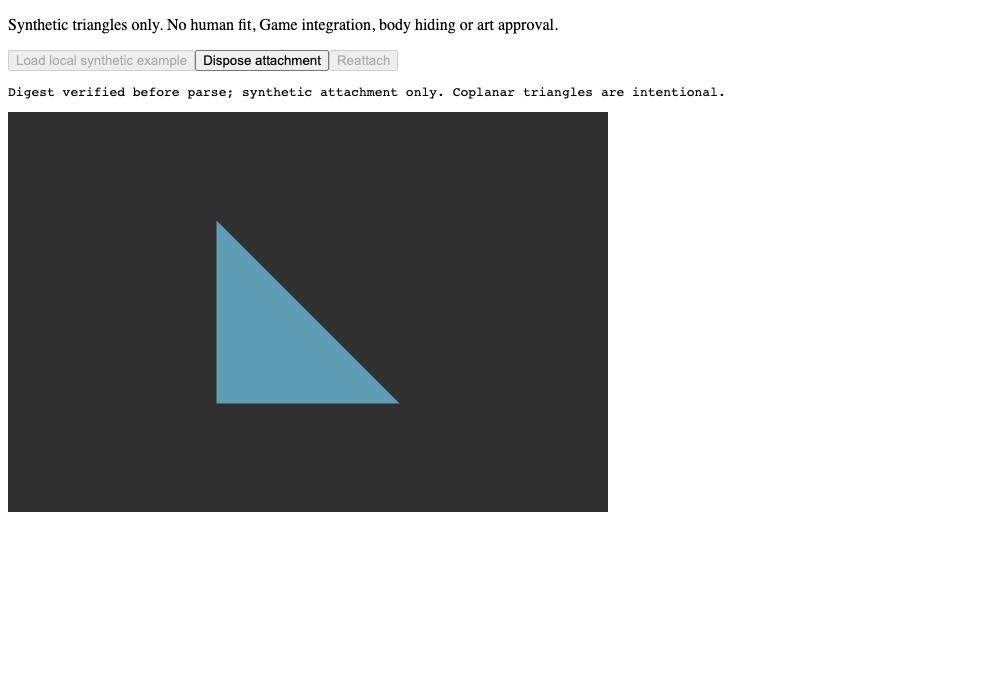
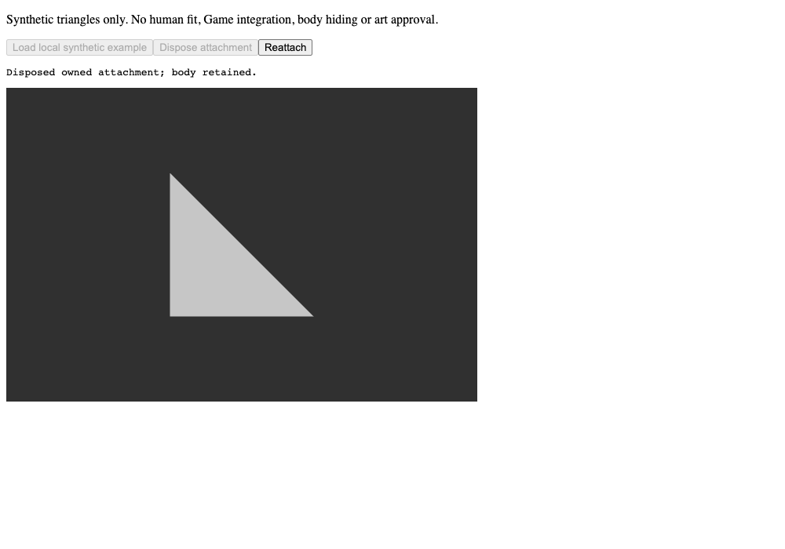

# Preview local do mecanismo de attachment

Capturas RAW do Chrome, viewport de 1000×700 e dpr 1, no código
`4789a909a9e07446d548c793c45b3e4ec928ea5d`. O preview é opt-in:
antes de clicar em Load, nenhum canvas ou GLB foi carregado.

Azul indica o triângulo da peça; cinza indica o triângulo do corpo.
Reattach reproduziu o canvas anexado, idêntico byte a byte. Os status e estados
dos três botões foram conferidos nos quatro estágios. WebCrypto verificou
os dois GLBs antes do parse; não houve erro de página ou console.

São triângulos sintéticos coplanares do exemplo existente. Estas imagens
mostram remoção/recriação e retenção do corpo. Fit humano, roupa final,
empunhadura, animação, loja e desempenho do jogo continuam fora desta prova.
O registro externo184 preserva três PNGs completos, três canvases, estados,
pins e recibo. A revisão visual independente fica registrada no documento de continuidade.
